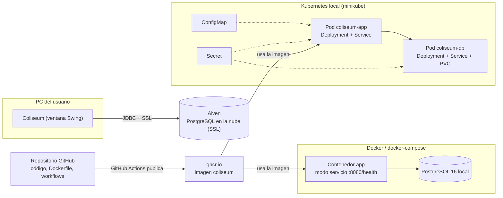
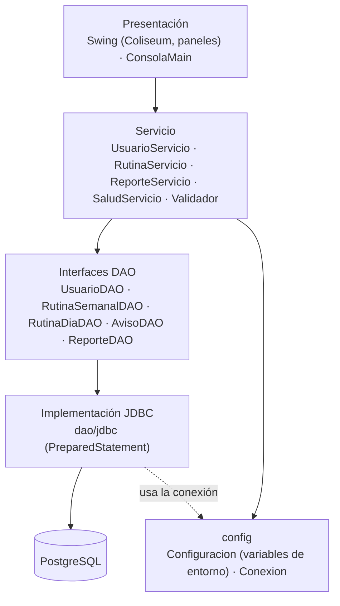

# Arquitectura de despliegue

Proyecto de **escritorio**: no usa Render. La ventana corre en la PC y se conecta a la base; en Docker y Kubernetes corre el modo servicio (sin ventana).

# Capas de la aplicación

