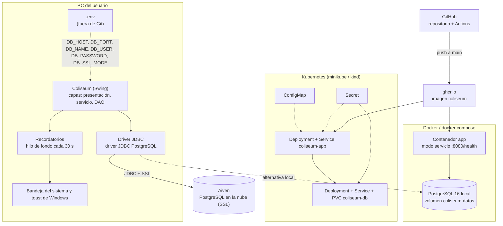
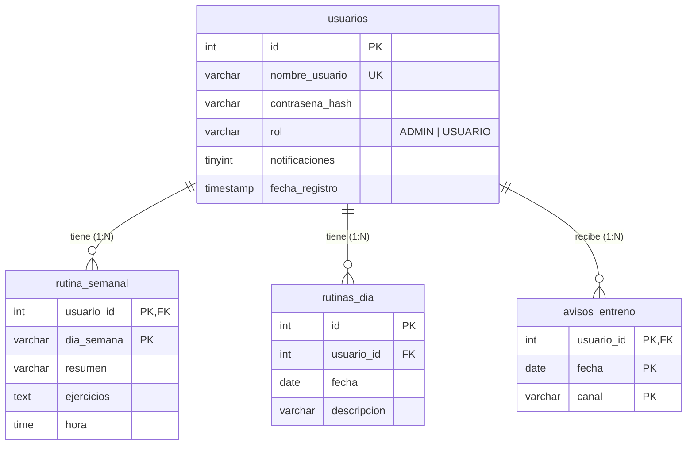

# Infraestructura - Coliseum

Coliseum es una aplicación **de escritorio**. La ventana Swing corre en la PC del usuario y se conecta a PostgreSQL. Para Docker y Kubernetes se usa el **modo servicio** (`consola.ConsolaMain --servicio`), sin ventana, que verifica la base y expone `GET /health`.

## Diagrama por entorno

| Entorno | Qué corre | Base de datos | Cómo se configura |
|---|---|---|---|
| PC (Nivel 2) | Ventana Swing (`Coliseum Launcher.bat`) | Aiven, con SSL | `.env` local |
| Docker (Nivel 1) | Contenedor `app` en modo servicio | Contenedor `db` (PostgreSQL 16) | `.env` leído por `docker-compose.yml` |
| Kubernetes (Nivel 3) | Pod `coliseum-app` | Pod `coliseum-db` con PVC | `ConfigMap` + `Secret` |

## Modelo de datos

| Tabla | Para qué sirve |
|---|---|
| `usuarios` | Usuario único, hash PBKDF2 de la contraseña, rol (`ADMIN`/`USUARIO`) y preferencia de notificaciones (sin elegir, activadas o desactivadas) |
| `rutina_semanal` | Resumen, ejercicios y hora de inicio de cada día de la semana |
| `rutinas_dia` | Notas de una fecha concreta del calendario |
| `avisos_entreno` | Avisos de entreno ya enviados, para no repetirlos (se limpian al guardar la rutina semanal) |

Todas las claves foráneas usan `ON DELETE CASCADE`: al borrar un usuario se borran sus rutinas y avisos. El esquema se crea **solo** con `sql/01-crear-tablas.sql` (idempotente); la aplicación no ejecuta DDL.

## Variables de entorno (R10)

| Variable | Uso |
|---|---|
| `DB_HOST`, `DB_PORT`, `DB_NAME` | Dónde está la base (por defecto el puerto es 5432) |
| `DB_USER`, `DB_PASSWORD` | Credenciales. No tienen valor por defecto |
| `DB_SSL_MODE` | `REQUIRED` (por defecto, Aiven) o `DISABLED` (solo la base local de Docker) |
| `APP_PORT` | Puerto de `/health` (8080 por defecto) |

El archivo `.env` está en `.gitignore`; `.env.example` lista los nombres sin valores.

## Requisitos para ejecutarlo

1. Java (JDK 11 o superior) para la ventana de escritorio.
2. Docker Desktop (`docker compose`), `kubectl` y `minikube` o `kind` para los niveles 1 y 3.
3. Una base PostgreSQL: la del contenedor (`docker compose up`) o la de Aiven.
4. `.env` completado a partir de `.env.example`.
5. Para las notificaciones de escritorio: Windows con PowerShell y las notificaciones activadas (Configuración > Sistema > Notificaciones).
6. Opcional: `coliseum.properties` junto al programa para ajustar los avisos.

| Propiedad | Por defecto | Para qué sirve |
|---|---|---|
| `recordatorio.hora_por_defecto` | `18:00` | Hora de entreno de los días sin hora propia |
| `recordatorio.minutos_antes` | `20` | Minutos de anticipación del aviso |
| `recordatorio.ventana_minutos` | `30` | Tolerancia para avisar si la app estaba cerrada |

## Modos de ejecución

| Comando | Qué hace |
|---|---|
| `src/Coliseum/Coliseum Launcher.bat` | Compila y abre la ventana (inicio de sesión) |
| `java Coliseum --recordatorios` | Servicio de avisos sin ventana para todos los usuarios |
| `java Coliseum --simular "AAAA-MM-DD HH:mm"` | Muestra a quién se avisaría en ese momento, sin enviar nada |
| `docker compose up --build` | App (modo servicio) y base local |
| `docker compose run --rm app --consola` | Menú de texto: sesión, notas, reportes y estado |
| `consola.ConsolaMain --health` | Código de salida 0 (todo bien) o 1 (falla); es el healthcheck de compose |
| `GET http://localhost:8080/health` | 200 si la app y la base funcionan, 503 si no |

## Archivos que genera

| Archivo | Para qué sirve |
|---|---|
| `coliseum.log` | Detalle técnico de los errores (el usuario solo ve mensajes claros). Está en `.gitignore` |
| `recordatorios.log` | Avisos enviados, reintentos y diagnósticos |
| `coliseum-recordatorios.lock` (carpeta temporal) | Evita dos servicios de avisos a la vez |
