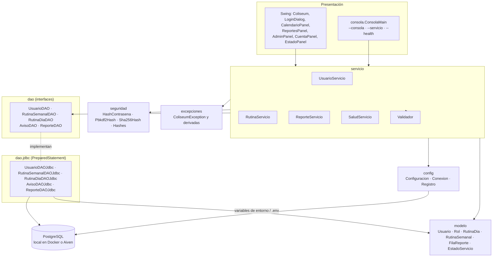
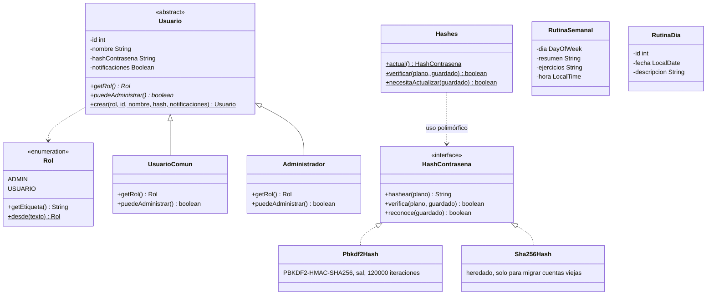
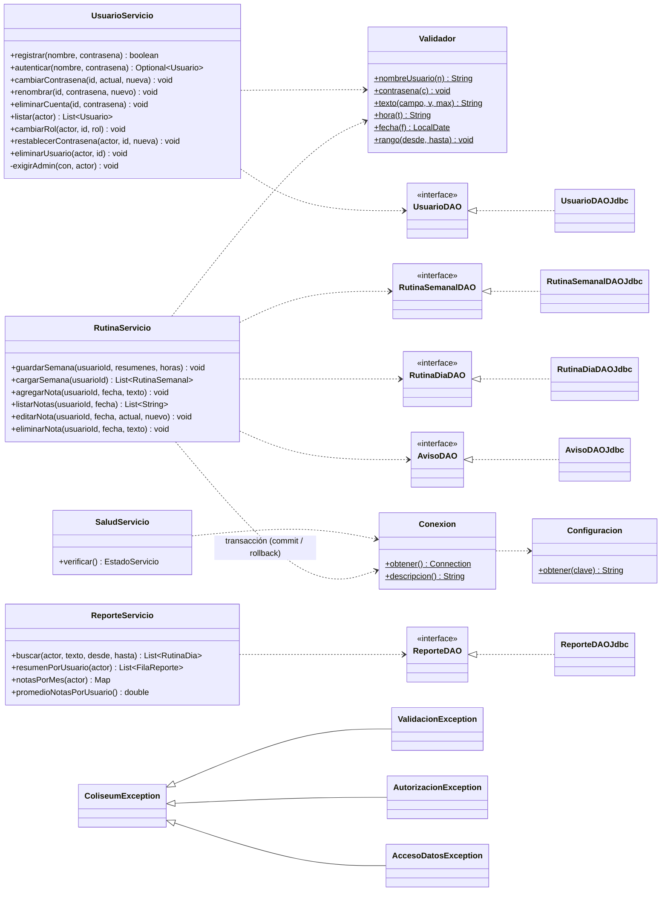
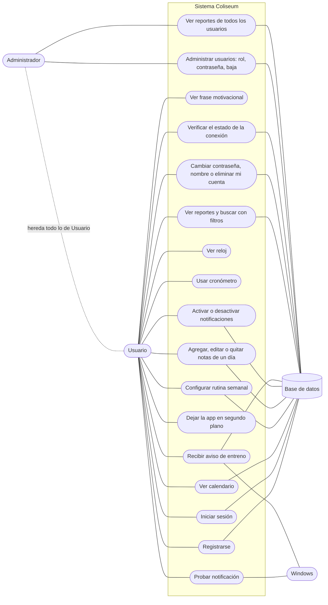

# Diagramas UML - Coliseum

Los diagramas muestran la versión actual: arquitectura en capas (R4), jerarquía de herencia e interfaz con dos implementaciones (R5), roles (R3) y excepciones propias (R8).

## 1. Capas y paquetes

## 2. Modelo de dominio y seguridad (R3, R5)

## 3. Servicios, DAO y excepciones (R4, R7, R8, R9)

## 4. Casos de uso

> Las clases de presentación y de recordatorios que viven en `Coliseum.java` (`Coliseum`, `LoginDialog`, `CalendarioPanel`, `Recordatorios`, `Bandeja`, `ToastWindows`, etc.) no se repiten aquí: llaman a la capa de servicio a través de la fachada `ConexionBD`, que ya no contiene SQL.
